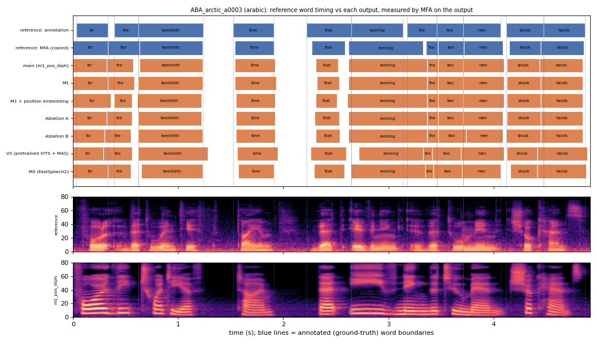

# ABA_arctic_a0003 (arabic, held-out test speaker)

**Selected as:** headline prompt

**Text:** For the twentieth time that evening the two men shook hands

**Reference (ground truth):** [`reference.wav`](reference.wav), L2-ARCTIC `ABA/wav/arctic_a0003.wav`, 4.92 s; ground-truth word timing: [`reference_annotation.TextGrid`](reference_annotation.TextGrid) (L2-ARCTIC manual annotation, the reference for every MAE below)

| System | Output | Length error (samples) | Word-boundary MAE (ms, MFA on output) | WER | UTMOS | US prob |
|---|---|---|---|---|---|---|
| main (m1_pos_diph) | [`m1_pos_diph.wav`](m1_pos_diph.wav) | 0 | 47.3 | 0.000 | 4.05 | 0.05 |
| M1 | [`m1.wav`](m1.wav) | 0 | 45.0 | 0.000 | 4.45 | 0.65 |
| M1 + position embedding | [`m1_pos.wav`](m1_pos.wav) | 0 | 46.4 | 0.000 | 4.06 | 0.03 |
| Ablation A | [`abl_a_pos.wav`](abl_a_pos.wav) | 0 | 45.9 | 0.000 | 4.02 | 0.64 |
| Ablation B | [`abl_b_pos.wav`](abl_b_pos.wav) | 0 | 50.0 | 0.091 | 4.01 | 0.96 |
| V0 (pretrained VITS + MAS) | [`v0.wav`](v0.wav) | 0 | 52.3 | 0.000 | 4.40 | 0.26 |
| M0 (FastSpeech2) | [`m0.wav`](m0.wav) | 0 | 46.8 | 0.000 | 4.22 | 0.98 |

**Word timings** (seconds). *Annotation* = human ground truth; *MFA on reference* = the timing the system copies (input); *output* = MFA on the m1_pos_diph output. Δ = output − annotation; the MAE above is the mean of |Δstart| and |Δend|, recomputed from these files and checked against `per_utt.csv`.

| Word | Annotation | MFA on reference | Output | Δstart (ms) | Δend (ms) |
|---|---|---|---|---|---|
| for | 0.03–0.33 | 0.00–0.33 | 0.00–0.32 | -30.0 | -10.0 |
| the | 0.39–0.62 | 0.33–0.63 | 0.32–0.57 | -70.0 | -50.0 |
| twentieth | 0.62–1.24 | 0.63–1.23 | 0.63–1.23 | 10.0 | -10.0 |
| time | 1.52–1.91 | 1.54–1.91 | 1.54–1.92 | 20.0 | 10.0 |
| that | 2.22–2.65 | 2.27–2.59 | 2.31–2.52 | 90.0 | -130.0 |
| evening | 2.65–3.14 | 2.62–3.33 | 2.62–3.37 | -30.0 | 230.0 |
| the | 3.18–3.46 | 3.36–3.47 | 3.37–3.47 | 190.0 | 10.0 |
| two | 3.46–3.71 | 3.47–3.72 | 3.47–3.71 | 10.0 | 0.0 |
| men | 3.71–4.07 | 3.72–4.09 | 3.71–4.10 | 0.0 | 30.0 |
| shook | 4.12–4.48 | 4.15–4.45 | 4.13–4.44 | 10.0 | -40.0 |
| hands | 4.48–4.87 | 4.45–4.86 | 4.44–4.85 | -40.0 | -20.0 |

All systems' planned and measured word timings: [`timings.json`](timings.json). Each wav is a byte-exact copy of `results/<system>/test/wav/ABA_arctic_a0003/out.wav` (see `../../../SOURCES.tsv`).
