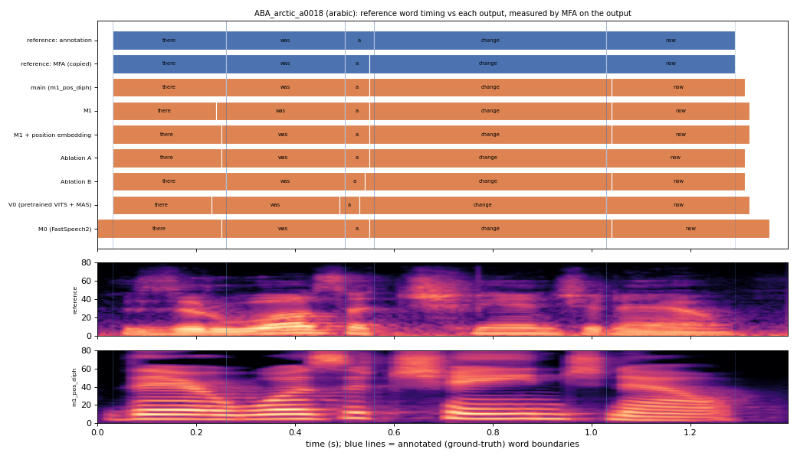

# ABA_arctic_a0018 (arabic, held-out test speaker)

**Selected as:** best main-system MAE (6.0 ms)

**Text:** There was a change now

**Reference (ground truth):** [`reference.wav`](reference.wav), L2-ARCTIC `ABA/wav/arctic_a0018.wav`, 1.40 s; ground-truth word timing: [`reference_annotation.TextGrid`](reference_annotation.TextGrid) (L2-ARCTIC manual annotation, the reference for every MAE below)

| System | Output | Length error (samples) | Word-boundary MAE (ms, MFA on output) | WER | UTMOS | US prob |
|---|---|---|---|---|---|---|
| main (m1_pos_diph) | [`m1_pos_diph.wav`](m1_pos_diph.wav) | 0 | 6.0 | 0.000 | 4.13 | 0.97 |
| M1 | [`m1.wav`](m1.wav) | 0 | 11.0 | 0.000 | 4.42 | 1.00 |
| M1 + position embedding | [`m1_pos.wav`](m1_pos.wav) | 0 | 9.0 | 0.000 | 4.31 | 0.98 |
| Ablation A | [`abl_a_pos.wav`](abl_a_pos.wav) | 0 | 6.0 | 0.400 | 4.37 | 0.99 |
| Ablation B | [`abl_b_pos.wav`](abl_b_pos.wav) | 0 | 8.0 | 0.200 | 4.34 | 1.00 |
| V0 (pretrained VITS + MAS) | [`v0.wav`](v0.wav) | 0 | 17.0 | 0.000 | 4.40 | 0.99 |
| M0 (FastSpeech2) | [`m0.wav`](m0.wav) | 0 | 16.0 | 0.200 | 4.35 | 0.66 |

**Word timings** (seconds). *Annotation* = human ground truth; *MFA on reference* = the timing the system copies (input); *output* = MFA on the m1_pos_diph output. Δ = output − annotation; the MAE above is the mean of |Δstart| and |Δend|, recomputed from these files and checked against `per_utt.csv`.

| Word | Annotation | MFA on reference | Output | Δstart (ms) | Δend (ms) |
|---|---|---|---|---|---|
| there | 0.03–0.26 | 0.03–0.26 | 0.03–0.26 | 0.0 | 0.0 |
| was | 0.26–0.50 | 0.26–0.50 | 0.26–0.50 | 0.0 | 0.0 |
| a | 0.50–0.56 | 0.50–0.55 | 0.50–0.55 | 0.0 | -10.0 |
| change | 0.56–1.03 | 0.55–1.03 | 0.55–1.04 | -10.0 | 10.0 |
| now | 1.03–1.29 | 1.03–1.29 | 1.04–1.31 | 10.0 | 20.0 |

All systems' planned and measured word timings: [`timings.json`](timings.json). Each wav is a byte-exact copy of `results/<system>/test/wav/ABA_arctic_a0018/out.wav` (see `../../../SOURCES.tsv`).
