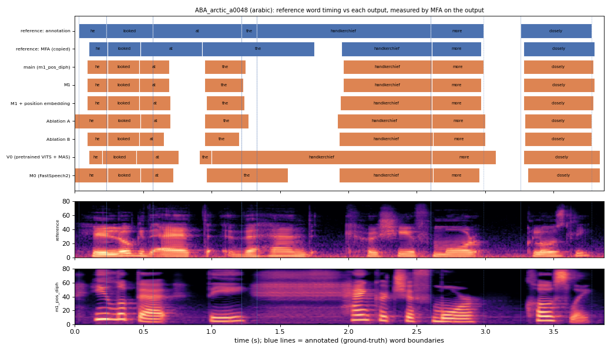

# ABA_arctic_a0048 (arabic, held-out test speaker)

**Selected as:** worst main-system MAE (131.4 ms)

**Text:** He looked at the handkerchief more closely

**Reference (ground truth):** [`reference.wav`](reference.wav), L2-ARCTIC `ABA/wav/arctic_a0048.wav`, 3.87 s; ground-truth word timing: [`reference_annotation.TextGrid`](reference_annotation.TextGrid) (L2-ARCTIC manual annotation, the reference for every MAE below)

| System | Output | Length error (samples) | Word-boundary MAE (ms, MFA on output) | WER | UTMOS | US prob |
|---|---|---|---|---|---|---|
| main (m1_pos_diph) | [`m1_pos_diph.wav`](m1_pos_diph.wav) | 0 | 131.4 | 0.000 | 4.17 | 0.72 |
| M1 | [`m1.wav`](m1.wav) | 0 | 135.0 | 0.000 | 4.07 | 0.95 |
| M1 + position embedding | [`m1_pos.wav`](m1_pos.wav) | 0 | 130.7 | 0.000 | 4.23 | 0.98 |
| Ablation A | [`abl_a_pos.wav`](abl_a_pos.wav) | 0 | 123.6 | 0.000 | 3.77 | 0.32 |
| Ablation B | [`abl_b_pos.wav`](abl_b_pos.wav) | 0 | 137.9 | 0.000 | 3.47 | 1.00 |
| V0 (pretrained VITS + MAS) | [`v0.wav`](v0.wav) | 0 | 142.1 | 0.000 | 4.07 | 0.89 |
| M0 (FastSpeech2) | [`m0.wav`](m0.wav) | 0 | 142.9 | 0.000 | 3.34 | 0.98 |

**Word timings** (seconds). *Annotation* = human ground truth; *MFA on reference* = the timing the system copies (input); *output* = MFA on the m1_pos_diph output. Δ = output − annotation; the MAE above is the mean of |Δstart| and |Δend|, recomputed from these files and checked against `per_utt.csv`.

| Word | Annotation | MFA on reference | Output | Δstart (ms) | Δend (ms) |
|---|---|---|---|---|---|
| he | 0.03–0.23 | 0.10–0.24 | 0.09–0.24 | 60.0 | 10.0 |
| looked | 0.23–0.57 | 0.24–0.48 | 0.24–0.47 | 10.0 | -100.0 |
| at | 0.57–1.22 | 0.48–0.93 | 0.47–0.69 | -100.0 | -530.0 |
| the | 1.22–1.33 | 0.93–1.75 | 0.95–1.25 | -270.0 | -80.0 |
| handkerchief | 1.33–2.60 | 1.95–2.61 | 1.96–2.61 | 630.0 | 10.0 |
| more | 2.60–2.99 | 2.61–2.97 | 2.61–2.99 | 10.0 | 0.0 |
| closely | 3.26–3.78 | 3.28–3.80 | 3.28–3.79 | 20.0 | 10.0 |

All systems' planned and measured word timings: [`timings.json`](timings.json). Each wav is a byte-exact copy of `results/<system>/test/wav/ABA_arctic_a0048/out.wav` (see `../../../SOURCES.tsv`).
