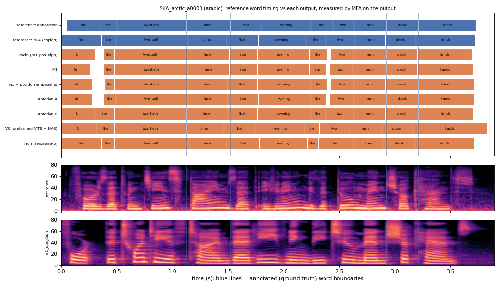

# SKA_arctic_a0003 (arabic, held-out test speaker)

**Selected as:** headline prompt

**Text:** For the twentieth time that evening the two men shook hands

**Reference (ground truth):** [`reference.wav`](reference.wav), L2-ARCTIC `SKA/wav/arctic_a0003.wav`, 3.89 s; ground-truth word timing: [`reference_annotation.TextGrid`](reference_annotation.TextGrid) (L2-ARCTIC manual annotation, the reference for every MAE below)

| System | Output | Length error (samples) | Word-boundary MAE (ms, MFA on output) | WER | UTMOS | US prob |
|---|---|---|---|---|---|---|
| main (m1_pos_diph) | [`m1_pos_diph.wav`](m1_pos_diph.wav) | 0 | 20.2 | 0.000 | 4.44 | 0.67 |
| M1 | [`m1.wav`](m1.wav) | 0 | 24.3 | 0.000 | 4.41 | 0.98 |
| M1 + position embedding | [`m1_pos.wav`](m1_pos.wav) | 0 | 21.6 | 0.000 | 4.43 | 0.93 |
| Ablation A | [`abl_a_pos.wav`](abl_a_pos.wav) | 0 | 19.3 | 0.000 | 4.22 | 0.82 |
| Ablation B | [`abl_b_pos.wav`](abl_b_pos.wav) | 0 | 22.0 | 0.000 | 4.15 | 0.99 |
| V0 (pretrained VITS + MAS) | [`v0.wav`](v0.wav) | 0 | 48.8 | 0.000 | 4.49 | 0.96 |
| M0 (FastSpeech2) | [`m0.wav`](m0.wav) | 0 | 32.5 | 0.091 | 4.45 | 1.00 |

**Word timings** (seconds). *Annotation* = human ground truth; *MFA on reference* = the timing the system copies (input); *output* = MFA on the m1_pos_diph output. Δ = output − annotation; the MAE above is the mean of |Δstart| and |Δend|, recomputed from these files and checked against `per_utt.csv`.

| Word | Annotation | MFA on reference | Output | Δstart (ms) | Δend (ms) |
|---|---|---|---|---|---|
| for | 0.05–0.35 | 0.00–0.36 | 0.00–0.30 | -50.0 | -50.0 |
| the | 0.35–0.50 | 0.36–0.49 | 0.38–0.48 | 30.0 | -20.0 |
| twentieth | 0.50–1.12 | 0.49–1.14 | 0.48–1.13 | -20.0 | 10.0 |
| time | 1.12–1.52 | 1.14–1.49 | 1.13–1.51 | 10.0 | -10.0 |
| that | 1.52–1.80 | 1.49–1.77 | 1.51–1.76 | -10.0 | -40.0 |
| evening | 1.80–2.24 | 1.77–2.20 | 1.76–2.23 | -40.0 | -12.3 |
| the | 2.24–2.44 | 2.20–2.38 | 2.23–2.39 | -12.3 | -50.0 |
| two | 2.44–2.63 | 2.38–2.64 | 2.42–2.63 | -20.0 | 0.0 |
| men | 2.63–2.92 | 2.64–2.91 | 2.63–2.92 | 0.0 | 0.0 |
| shook | 2.92–3.21 | 2.91–3.19 | 2.92–3.20 | 0.0 | -10.0 |
| hands | 3.21–3.73 | 3.19–3.72 | 3.20–3.69 | -10.0 | -40.0 |

All systems' planned and measured word timings: [`timings.json`](timings.json). Each wav is a byte-exact copy of `results/<system>/test/wav/SKA_arctic_a0003/out.wav` (see `../../../SOURCES.tsv`).
