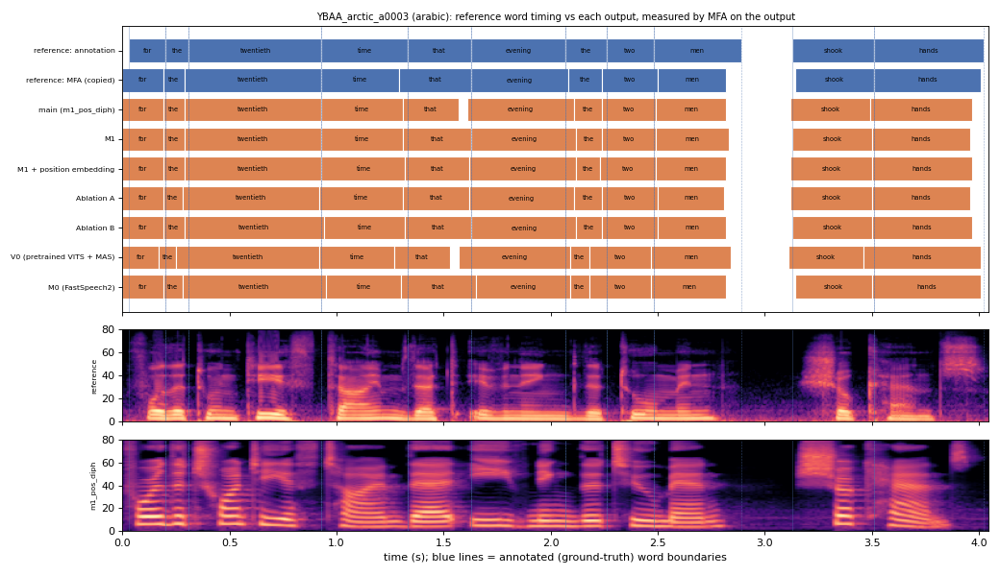

# YBAA_arctic_a0003 (arabic, held-out test speaker)

**Selected as:** headline prompt

**Text:** For the twentieth time that evening the two men shook hands

**Reference (ground truth):** [`reference.wav`](reference.wav), L2-ARCTIC `YBAA/wav/arctic_a0003.wav`, 4.04 s; ground-truth word timing: [`reference_annotation.TextGrid`](reference_annotation.TextGrid) (L2-ARCTIC manual annotation, the reference for every MAE below)

| System | Output | Length error (samples) | Word-boundary MAE (ms, MFA on output) | WER | UTMOS | US prob |
|---|---|---|---|---|---|---|
| main (m1_pos_diph) | [`m1_pos_diph.wav`](m1_pos_diph.wav) | 0 | 23.6 | 0.000 | 4.47 | 0.71 |
| M1 | [`m1.wav`](m1.wav) | 0 | 19.5 | 0.000 | 4.47 | 0.28 |
| M1 + position embedding | [`m1_pos.wav`](m1_pos.wav) | 0 | 20.9 | 0.000 | 4.49 | 0.99 |
| Ablation A | [`abl_a_pos.wav`](abl_a_pos.wav) | 0 | 23.6 | 0.000 | 4.03 | 0.33 |
| Ablation B | [`abl_b_pos.wav`](abl_b_pos.wav) | 0 | 20.5 | 0.000 | 4.43 | 0.98 |
| V0 (pretrained VITS + MAS) | [`v0.wav`](v0.wav) | 0 | 41.4 | 0.000 | 4.49 | 0.95 |
| M0 (FastSpeech2) | [`m0.wav`](m0.wav) | 0 | 26.4 | 0.000 | 4.47 | 1.00 |

**Word timings** (seconds). *Annotation* = human ground truth; *MFA on reference* = the timing the system copies (input); *output* = MFA on the m1_pos_diph output. Δ = output − annotation; the MAE above is the mean of |Δstart| and |Δend|, recomputed from these files and checked against `per_utt.csv`.

| Word | Annotation | MFA on reference | Output | Δstart (ms) | Δend (ms) |
|---|---|---|---|---|---|
| for | 0.03–0.20 | 0.00–0.19 | 0.00–0.19 | -30.0 | -10.0 |
| the | 0.20–0.31 | 0.19–0.29 | 0.19–0.29 | -10.0 | -20.0 |
| twentieth | 0.31–0.93 | 0.29–0.93 | 0.29–0.93 | -20.0 | 0.0 |
| time | 0.93–1.33 | 0.93–1.29 | 0.93–1.31 | 0.0 | -20.0 |
| that | 1.33–1.63 | 1.29–1.63 | 1.31–1.57 | -20.0 | -60.0 |
| evening | 1.63–2.07 | 1.63–2.08 | 1.61–2.11 | -20.0 | 40.0 |
| the | 2.07–2.26 | 2.08–2.24 | 2.11–2.24 | 40.0 | -20.0 |
| two | 2.26–2.48 | 2.24–2.50 | 2.24–2.49 | -20.0 | 10.0 |
| men | 2.48–2.89 | 2.50–2.82 | 2.49–2.82 | 10.0 | -70.0 |
| shook | 3.13–3.51 | 3.14–3.51 | 3.12–3.49 | -10.0 | -20.0 |
| hands | 3.51–4.02 | 3.51–4.01 | 3.49–3.97 | -20.0 | -50.0 |

All systems' planned and measured word timings: [`timings.json`](timings.json). Each wav is a byte-exact copy of `results/<system>/test/wav/YBAA_arctic_a0003/out.wav` (see `../../../SOURCES.tsv`).
