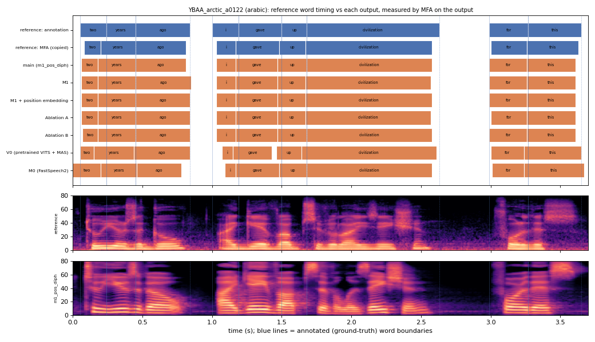

# YBAA_arctic_a0122 (arabic, held-out test speaker)

**Selected as:** median main-system MAE (22.2 ms)

**Text:** Two years ago I gave up civilization for this

**Reference (ground truth):** [`reference.wav`](reference.wav), L2-ARCTIC `YBAA/wav/arctic_a0122.wav`, 3.70 s; ground-truth word timing: [`reference_annotation.TextGrid`](reference_annotation.TextGrid) (L2-ARCTIC manual annotation, the reference for every MAE below)

| System | Output | Length error (samples) | Word-boundary MAE (ms, MFA on output) | WER | UTMOS | US prob |
|---|---|---|---|---|---|---|
| main (m1_pos_diph) | [`m1_pos_diph.wav`](m1_pos_diph.wav) | 0 | 22.2 | 0.000 | 4.41 | 0.01 |
| M1 | [`m1.wav`](m1.wav) | 0 | 22.8 | 0.000 | 4.32 | 0.00 |
| M1 + position embedding | [`m1_pos.wav`](m1_pos.wav) | 0 | 21.7 | 0.000 | 4.46 | 0.03 |
| Ablation A | [`abl_a_pos.wav`](abl_a_pos.wav) | 0 | 22.8 | 0.000 | 3.98 | 0.42 |
| Ablation B | [`abl_b_pos.wav`](abl_b_pos.wav) | 0 | 21.1 | 0.000 | 4.37 | 0.00 |
| V0 (pretrained VITS + MAS) | [`v0.wav`](v0.wav) | 0 | 35.0 | 0.000 | 4.44 | 0.01 |
| M0 (FastSpeech2) | [`m0.wav`](m0.wav) | 0 | 29.4 | 0.111 | 4.36 | 0.99 |

**Word timings** (seconds). *Annotation* = human ground truth; *MFA on reference* = the timing the system copies (input); *output* = MFA on the m1_pos_diph output. Δ = output − annotation; the MAE above is the mean of |Δstart| and |Δend|, recomputed from these files and checked against `per_utt.csv`.

| Word | Annotation | MFA on reference | Output | Δstart (ms) | Δend (ms) |
|---|---|---|---|---|---|
| two | 0.05–0.24 | 0.08–0.20 | 0.06–0.18 | 10.0 | -60.0 |
| years | 0.24–0.45 | 0.20–0.45 | 0.18–0.45 | -60.0 | 0.0 |
| ago | 0.45–0.84 | 0.45–0.81 | 0.45–0.81 | 0.0 | -30.0 |
| i | 1.00–1.19 | 1.03–1.17 | 1.03–1.17 | 30.0 | -20.0 |
| gave | 1.19–1.50 | 1.17–1.48 | 1.17–1.47 | -20.0 | -30.0 |
| up | 1.50–1.68 | 1.48–1.67 | 1.47–1.68 | -30.0 | 0.0 |
| civilization | 1.68–2.63 | 1.67–2.58 | 1.68–2.58 | 0.0 | -50.0 |
| for | 2.99–3.27 | 3.00–3.26 | 2.99–3.26 | 0.0 | -10.0 |
| this | 3.27–3.65 | 3.26–3.63 | 3.26–3.61 | -10.0 | -40.0 |

All systems' planned and measured word timings: [`timings.json`](timings.json). Each wav is a byte-exact copy of `results/<system>/test/wav/YBAA_arctic_a0122/out.wav` (see `../../../SOURCES.tsv`).
