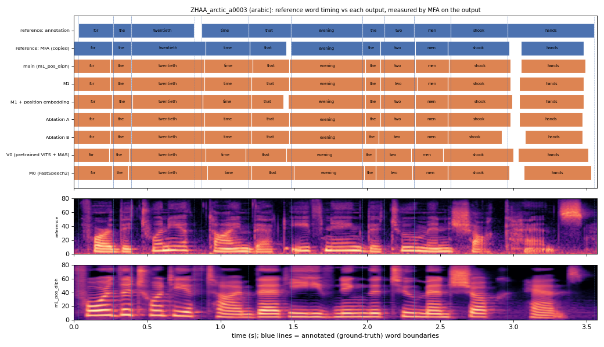

# ZHAA_arctic_a0003 (arabic, held-out test speaker)

**Selected as:** headline prompt

**Text:** For the twentieth time that evening the two men shook hands

**Reference (ground truth):** [`reference.wav`](reference.wav), L2-ARCTIC `ZHAA/wav/arctic_a0003.wav`, 3.57 s; ground-truth word timing: [`reference_annotation.TextGrid`](reference_annotation.TextGrid) (L2-ARCTIC manual annotation, the reference for every MAE below)

| System | Output | Length error (samples) | Word-boundary MAE (ms, MFA on output) | WER | UTMOS | US prob |
|---|---|---|---|---|---|---|
| main (m1_pos_diph) | [`m1_pos_diph.wav`](m1_pos_diph.wav) | 0 | 25.0 | 0.000 | 4.27 | 0.48 |
| M1 | [`m1.wav`](m1.wav) | 0 | 25.9 | 0.000 | 4.30 | 0.76 |
| M1 + position embedding | [`m1_pos.wav`](m1_pos.wav) | 0 | 26.8 | 0.000 | 4.46 | 0.89 |
| Ablation A | [`abl_a_pos.wav`](abl_a_pos.wav) | 0 | 25.5 | 0.000 | 3.86 | 0.74 |
| Ablation B | [`abl_b_pos.wav`](abl_b_pos.wav) | 0 | 29.1 | 0.000 | 4.43 | 0.97 |
| V0 (pretrained VITS + MAS) | [`v0.wav`](v0.wav) | 0 | 33.2 | 0.182 | 4.47 | 0.85 |
| M0 (FastSpeech2) | [`m0.wav`](m0.wav) | 0 | 29.1 | 0.000 | 4.11 | 0.98 |

**Word timings** (seconds). *Annotation* = human ground truth; *MFA on reference* = the timing the system copies (input); *output* = MFA on the m1_pos_diph output. Δ = output − annotation; the MAE above is the mean of |Δstart| and |Δend|, recomputed from these files and checked against `per_utt.csv`.

| Word | Annotation | MFA on reference | Output | Δstart (ms) | Δend (ms) |
|---|---|---|---|---|---|
| for | 0.03–0.27 | 0.00–0.26 | 0.00–0.25 | -30.0 | -20.0 |
| the | 0.27–0.39 | 0.26–0.39 | 0.25–0.39 | -20.0 | 0.0 |
| twentieth | 0.39–0.82 | 0.39–0.90 | 0.39–0.89 | 0.0 | 70.0 |
| time | 0.87–1.19 | 0.90–1.20 | 0.89–1.22 | 20.0 | 30.0 |
| that | 1.19–1.48 | 1.20–1.45 | 1.22–1.47 | 30.0 | -10.0 |
| evening | 1.48–1.97 | 1.48–1.97 | 1.47–1.99 | -10.0 | 20.0 |
| the | 1.97–2.12 | 1.97–2.09 | 1.99–2.09 | 20.0 | -30.0 |
| two | 2.12–2.32 | 2.09–2.33 | 2.09–2.33 | -30.0 | 10.0 |
| men | 2.32–2.57 | 2.33–2.55 | 2.33–2.56 | 10.0 | -10.0 |
| shook | 2.57–2.96 | 2.55–2.97 | 2.56–2.98 | -10.0 | 20.0 |
| hands | 2.96–3.55 | 3.05–3.48 | 3.05–3.49 | 90.0 | -60.0 |

All systems' planned and measured word timings: [`timings.json`](timings.json). Each wav is a byte-exact copy of `results/<system>/test/wav/ZHAA_arctic_a0003/out.wav` (see `../../../SOURCES.tsv`).
