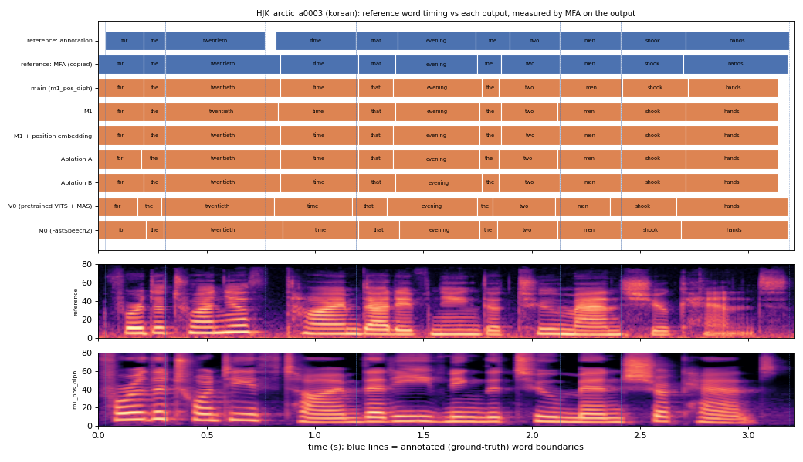

# HJK_arctic_a0003 (korean, held-out test speaker)

**Selected as:** headline prompt

**Text:** For the twentieth time that evening the two men shook hands

**Reference (ground truth):** [`reference.wav`](reference.wav), L2-ARCTIC `HJK/wav/arctic_a0003.wav`, 3.21 s; ground-truth word timing: [`reference_annotation.TextGrid`](reference_annotation.TextGrid) (L2-ARCTIC manual annotation, the reference for every MAE below)

| System | Output | Length error (samples) | Word-boundary MAE (ms, MFA on output) | WER | UTMOS | US prob |
|---|---|---|---|---|---|---|
| main (m1_pos_diph) | [`m1_pos_diph.wav`](m1_pos_diph.wav) | 0 | 19.5 | 0.000 | 4.31 | 0.73 |
| M1 | [`m1.wav`](m1.wav) | 0 | 15.0 | 0.000 | 4.38 | 0.77 |
| M1 + position embedding | [`m1_pos.wav`](m1_pos.wav) | 0 | 15.9 | 0.000 | 4.46 | 0.95 |
| Ablation A | [`abl_a_pos.wav`](abl_a_pos.wav) | 0 | 18.6 | 0.000 | 4.45 | 0.65 |
| Ablation B | [`abl_b_pos.wav`](abl_b_pos.wav) | 0 | 16.8 | 0.000 | 4.43 | 0.91 |
| V0 (pretrained VITS + MAS) | [`v0.wav`](v0.wav) | 0 | 33.2 | 0.000 | 4.47 | 0.24 |
| M0 (FastSpeech2) | [`m0.wav`](m0.wav) | 0 | 20.5 | 0.000 | 4.41 | 1.00 |

**Word timings** (seconds). *Annotation* = human ground truth; *MFA on reference* = the timing the system copies (input); *output* = MFA on the m1_pos_diph output. Δ = output − annotation; the MAE above is the mean of |Δstart| and |Δend|, recomputed from these files and checked against `per_utt.csv`.

| Word | Annotation | MFA on reference | Output | Δstart (ms) | Δend (ms) |
|---|---|---|---|---|---|
| for | 0.03–0.21 | 0.00–0.21 | 0.00–0.21 | -30.0 | 0.0 |
| the | 0.21–0.31 | 0.21–0.31 | 0.21–0.31 | 0.0 | 0.0 |
| twentieth | 0.31–0.77 | 0.31–0.84 | 0.31–0.84 | 0.0 | 70.0 |
| time | 0.82–1.19 | 0.84–1.20 | 0.84–1.20 | 20.0 | 10.0 |
| that | 1.19–1.38 | 1.20–1.37 | 1.20–1.36 | 10.0 | -20.0 |
| evening | 1.38–1.74 | 1.37–1.75 | 1.36–1.77 | -20.0 | 30.0 |
| the | 1.74–1.90 | 1.75–1.86 | 1.77–1.85 | 30.0 | -50.0 |
| two | 1.90–2.13 | 1.86–2.13 | 1.85–2.13 | -50.0 | 0.0 |
| men | 2.13–2.41 | 2.13–2.41 | 2.13–2.42 | 0.0 | 10.0 |
| shook | 2.41–2.71 | 2.41–2.70 | 2.42–2.72 | 10.0 | 10.0 |
| hands | 2.71–3.19 | 2.70–3.18 | 2.72–3.14 | 10.0 | -50.0 |

All systems' planned and measured word timings: [`timings.json`](timings.json). Each wav is a byte-exact copy of `results/<system>/test/wav/HJK_arctic_a0003/out.wav` (see `../../../SOURCES.tsv`).
