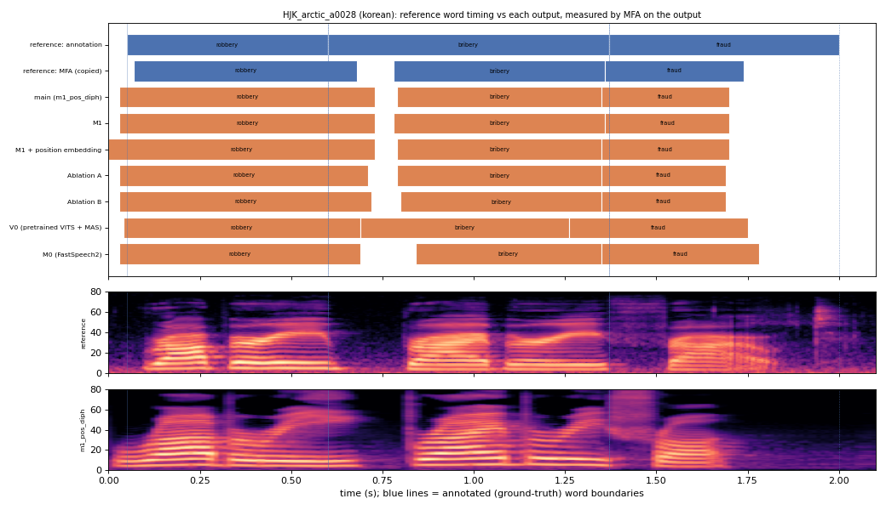

# HJK_arctic_a0028 (korean, held-out test speaker)

**Selected as:** worst main-system MAE (113.3 ms)

**Text:** Robbery bribery fraud

**Reference (ground truth):** [`reference.wav`](reference.wav), L2-ARCTIC `HJK/wav/arctic_a0028.wav`, 2.10 s; ground-truth word timing: [`reference_annotation.TextGrid`](reference_annotation.TextGrid) (L2-ARCTIC manual annotation, the reference for every MAE below)

| System | Output | Length error (samples) | Word-boundary MAE (ms, MFA on output) | WER | UTMOS | US prob |
|---|---|---|---|---|---|---|
| main (m1_pos_diph) | [`m1_pos_diph.wav`](m1_pos_diph.wav) | 0 | 113.3 | 0.000 | 3.28 | 1.00 |
| M1 | [`m1.wav`](m1.wav) | 0 | 108.3 | 0.000 | 3.43 | 1.00 |
| M1 + position embedding | [`m1_pos.wav`](m1_pos.wav) | 0 | 118.3 | 0.333 | 3.37 | 0.26 |
| Ablation A | [`abl_a_pos.wav`](abl_a_pos.wav) | 0 | 111.7 | 0.000 | 3.92 | 0.10 |
| Ablation B | [`abl_b_pos.wav`](abl_b_pos.wav) | 0 | 115.0 | 0.333 | 3.27 | 0.68 |
| V0 (pretrained VITS + MAS) | [`v0.wav`](v0.wav) | 0 | 110.0 | 0.000 | 3.54 | 0.95 |
| M0 (FastSpeech2) | [`m0.wav`](m0.wav) | 0 | 101.7 | 1.000 | 3.48 | 0.31 |

**Word timings** (seconds). *Annotation* = human ground truth; *MFA on reference* = the timing the system copies (input); *output* = MFA on the m1_pos_diph output. Δ = output − annotation; the MAE above is the mean of |Δstart| and |Δend|, recomputed from these files and checked against `per_utt.csv`.

| Word | Annotation | MFA on reference | Output | Δstart (ms) | Δend (ms) |
|---|---|---|---|---|---|
| robbery | 0.05–0.60 | 0.07–0.68 | 0.03–0.73 | -20.0 | 130.0 |
| bribery | 0.60–1.37 | 0.78–1.36 | 0.79–1.35 | 190.0 | -20.0 |
| fraud | 1.37–2.00 | 1.36–1.74 | 1.35–1.70 | -20.0 | -300.0 |

All systems' planned and measured word timings: [`timings.json`](timings.json). Each wav is a byte-exact copy of `results/<system>/test/wav/HJK_arctic_a0028/out.wav` (see `../../../SOURCES.tsv`).
