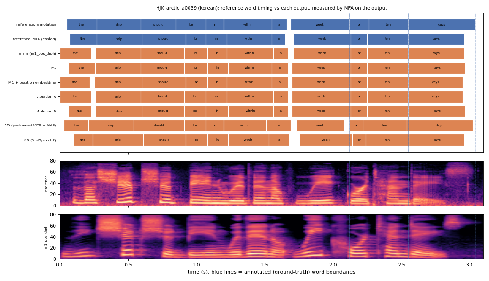

# HJK_arctic_a0039 (korean, held-out test speaker)

**Selected as:** median main-system MAE (20.5 ms)

**Text:** The ship should be in within a week or ten days

**Reference (ground truth):** [`reference.wav`](reference.wav), L2-ARCTIC `HJK/wav/arctic_a0039.wav`, 3.10 s; ground-truth word timing: [`reference_annotation.TextGrid`](reference_annotation.TextGrid) (L2-ARCTIC manual annotation, the reference for every MAE below)

| System | Output | Length error (samples) | Word-boundary MAE (ms, MFA on output) | WER | UTMOS | US prob |
|---|---|---|---|---|---|---|
| main (m1_pos_diph) | [`m1_pos_diph.wav`](m1_pos_diph.wav) | 0 | 20.5 | 0.091 | 4.12 | 0.05 |
| M1 | [`m1.wav`](m1.wav) | 0 | 16.4 | 0.091 | 4.44 | 0.11 |
| M1 + position embedding | [`m1_pos.wav`](m1_pos.wav) | 0 | 22.3 | 0.273 | 4.45 | 0.01 |
| Ablation A | [`abl_a_pos.wav`](abl_a_pos.wav) | 0 | 19.5 | 0.091 | 4.37 | 0.03 |
| Ablation B | [`abl_b_pos.wav`](abl_b_pos.wav) | 0 | 18.6 | 0.091 | 4.31 | 0.92 |
| V0 (pretrained VITS + MAS) | [`v0.wav`](v0.wav) | 0 | 30.5 | 0.091 | 4.45 | 1.00 |
| M0 (FastSpeech2) | [`m0.wav`](m0.wav) | 0 | 30.5 | 0.182 | 4.08 | 0.99 |

**Word timings** (seconds). *Annotation* = human ground truth; *MFA on reference* = the timing the system copies (input); *output* = MFA on the m1_pos_diph output. Δ = output − annotation; the MAE above is the mean of |Δstart| and |Δend|, recomputed from these files and checked against `per_utt.csv`.

| Word | Annotation | MFA on reference | Output | Δstart (ms) | Δend (ms) |
|---|---|---|---|---|---|
| the | 0.05–0.27 | 0.07–0.27 | 0.00–0.23 | -50.0 | -40.0 |
| ship | 0.27–0.59 | 0.27–0.60 | 0.26–0.59 | -10.0 | 0.0 |
| should | 0.59–0.85 | 0.60–0.92 | 0.59–0.91 | 0.0 | 60.0 |
| be | 0.85–1.07 | 0.92–1.07 | 0.91–1.08 | 60.0 | 10.0 |
| in | 1.07–1.20 | 1.07–1.22 | 1.08–1.22 | 10.0 | 20.0 |
| within | 1.20–1.55 | 1.22–1.55 | 1.22–1.56 | 20.0 | 10.0 |
| a | 1.55–1.66 | 1.55–1.65 | 1.56–1.67 | 10.0 | 10.0 |
| week | 1.69–2.12 | 1.71–2.13 | 1.71–2.13 | 20.0 | 10.0 |
| or | 2.12–2.26 | 2.13–2.25 | 2.13–2.25 | 10.0 | -10.0 |
| ten | 2.26–2.55 | 2.25–2.55 | 2.25–2.55 | -10.0 | 0.0 |
| days | 2.55–3.04 | 2.55–2.96 | 2.55–2.96 | 0.0 | -80.0 |

All systems' planned and measured word timings: [`timings.json`](timings.json). Each wav is a byte-exact copy of `results/<system>/test/wav/HJK_arctic_a0039/out.wav` (see `../../../SOURCES.tsv`).
