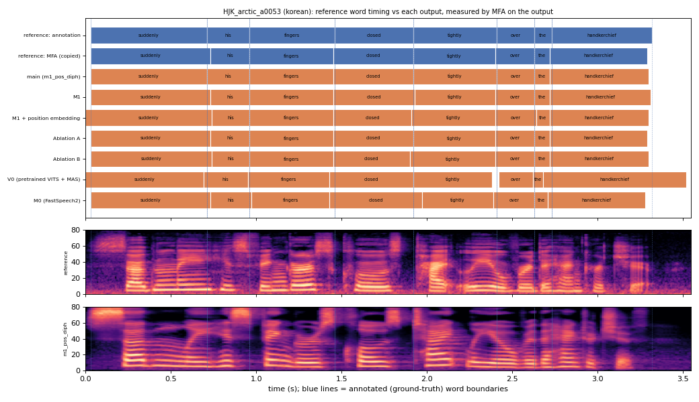

# HJK_arctic_a0053 (korean, held-out test speaker)

**Selected as:** best main-system MAE (3.7 ms)

**Text:** Suddenly his fingers closed tightly over the handkerchief

**Reference (ground truth):** [`reference.wav`](reference.wav), L2-ARCTIC `HJK/wav/arctic_a0053.wav`, 3.55 s; ground-truth word timing: [`reference_annotation.TextGrid`](reference_annotation.TextGrid) (L2-ARCTIC manual annotation, the reference for every MAE below)

| System | Output | Length error (samples) | Word-boundary MAE (ms, MFA on output) | WER | UTMOS | US prob |
|---|---|---|---|---|---|---|
| main (m1_pos_diph) | [`m1_pos_diph.wav`](m1_pos_diph.wav) | 0 | 3.8 | 0.000 | 4.35 | 1.00 |
| M1 | [`m1.wav`](m1.wav) | 0 | 8.1 | 0.000 | 4.33 | 0.95 |
| M1 + position embedding | [`m1_pos.wav`](m1_pos.wav) | 0 | 13.1 | 0.000 | 4.42 | 0.99 |
| Ablation A | [`abl_a_pos.wav`](abl_a_pos.wav) | 0 | 8.1 | 0.000 | 4.07 | 0.96 |
| Ablation B | [`abl_b_pos.wav`](abl_b_pos.wav) | 0 | 11.2 | 0.000 | 4.40 | 0.99 |
| V0 (pretrained VITS + MAS) | [`v0.wav`](v0.wav) | 0 | 31.9 | 0.000 | 4.37 | 0.29 |
| M0 (FastSpeech2) | [`m0.wav`](m0.wav) | 0 | 21.2 | 0.125 | 4.40 | 1.00 |

**Word timings** (seconds). *Annotation* = human ground truth; *MFA on reference* = the timing the system copies (input); *output* = MFA on the m1_pos_diph output. Δ = output − annotation; the MAE above is the mean of |Δstart| and |Δend|, recomputed from these files and checked against `per_utt.csv`.

| Word | Annotation | MFA on reference | Output | Δstart (ms) | Δend (ms) |
|---|---|---|---|---|---|
| suddenly | 0.03–0.71 | 0.03–0.73 | 0.03–0.71 | 0.0 | 0.0 |
| his | 0.71–0.96 | 0.73–0.96 | 0.71–0.96 | 0.0 | 0.0 |
| fingers | 0.96–1.46 | 0.96–1.45 | 0.96–1.45 | 0.0 | -10.0 |
| closed | 1.46–1.92 | 1.45–1.92 | 1.45–1.92 | -10.0 | 0.0 |
| tightly | 1.92–2.41 | 1.92–2.40 | 1.92–2.41 | 0.0 | 0.0 |
| over | 2.41–2.63 | 2.40–2.63 | 2.41–2.63 | 0.0 | 0.0 |
| the | 2.63–2.73 | 2.63–2.72 | 2.63–2.72 | 0.0 | -10.0 |
| handkerchief | 2.73–3.32 | 2.72–3.29 | 2.72–3.30 | -10.0 | -20.0 |

All systems' planned and measured word timings: [`timings.json`](timings.json). Each wav is a byte-exact copy of `results/<system>/test/wav/HJK_arctic_a0053/out.wav` (see `../../../SOURCES.tsv`).
