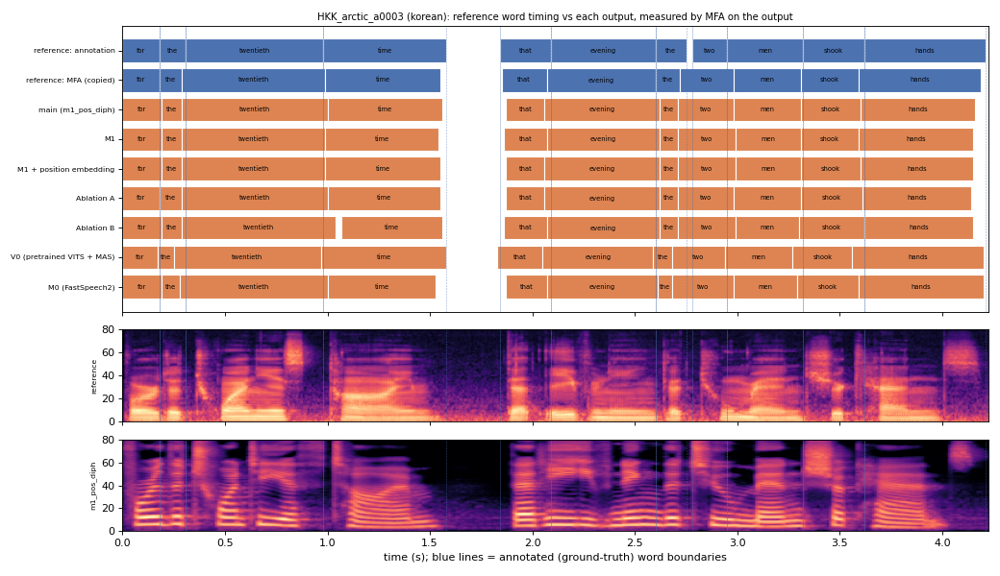

# HKK_arctic_a0003 (korean, held-out test speaker)

**Selected as:** headline prompt

**Text:** For the twentieth time that evening the two men shook hands

**Reference (ground truth):** [`reference.wav`](reference.wav), L2-ARCTIC `HKK/wav/arctic_a0003.wav`, 4.23 s; ground-truth word timing: [`reference_annotation.TextGrid`](reference_annotation.TextGrid) (L2-ARCTIC manual annotation, the reference for every MAE below)

| System | Output | Length error (samples) | Word-boundary MAE (ms, MFA on output) | WER | UTMOS | US prob |
|---|---|---|---|---|---|---|
| main (m1_pos_diph) | [`m1_pos_diph.wav`](m1_pos_diph.wav) | 0 | 24.1 | 0.000 | 4.23 | 0.99 |
| M1 | [`m1.wav`](m1.wav) | 0 | 25.0 | 0.000 | 4.47 | 0.97 |
| M1 + position embedding | [`m1_pos.wav`](m1_pos.wav) | 0 | 25.0 | 0.000 | 4.39 | 0.99 |
| Ablation A | [`abl_a_pos.wav`](abl_a_pos.wav) | 0 | 23.6 | 0.000 | 4.18 | 0.72 |
| Ablation B | [`abl_b_pos.wav`](abl_b_pos.wav) | 0 | 28.2 | 0.000 | 4.33 | 0.99 |
| V0 (pretrained VITS + MAS) | [`v0.wav`](v0.wav) | 0 | 31.4 | 0.000 | 4.47 | 0.86 |
| M0 (FastSpeech2) | [`m0.wav`](m0.wav) | 0 | 28.2 | 0.000 | 3.85 | 0.99 |

**Word timings** (seconds). *Annotation* = human ground truth; *MFA on reference* = the timing the system copies (input); *output* = MFA on the m1_pos_diph output. Δ = output − annotation; the MAE above is the mean of |Δstart| and |Δend|, recomputed from these files and checked against `per_utt.csv`.

| Word | Annotation | MFA on reference | Output | Δstart (ms) | Δend (ms) |
|---|---|---|---|---|---|
| for | 0.00–0.18 | 0.00–0.18 | 0.00–0.19 | 0.0 | 10.0 |
| the | 0.18–0.31 | 0.18–0.29 | 0.19–0.29 | 10.0 | -20.0 |
| twentieth | 0.31–0.98 | 0.29–0.99 | 0.29–1.00 | -20.0 | 20.0 |
| time | 0.98–1.58 | 0.99–1.55 | 1.00–1.56 | 20.0 | -20.0 |
| that | 1.84–2.09 | 1.85–2.07 | 1.87–2.06 | 30.0 | -30.0 |
| evening | 2.09–2.60 | 2.07–2.60 | 2.06–2.62 | -30.0 | 20.0 |
| the | 2.60–2.75 | 2.60–2.72 | 2.62–2.71 | 20.0 | -40.0 |
| two | 2.78–2.95 | 2.72–2.98 | 2.71–2.98 | -70.0 | 30.0 |
| men | 2.95–3.32 | 2.98–3.31 | 2.98–3.31 | 30.0 | -10.0 |
| shook | 3.32–3.62 | 3.31–3.59 | 3.31–3.60 | -10.0 | -20.0 |
| hands | 3.62–4.21 | 3.59–4.19 | 3.60–4.16 | -20.0 | -50.0 |

All systems' planned and measured word timings: [`timings.json`](timings.json). Each wav is a byte-exact copy of `results/<system>/test/wav/HKK_arctic_a0003/out.wav` (see `../../../SOURCES.tsv`).
