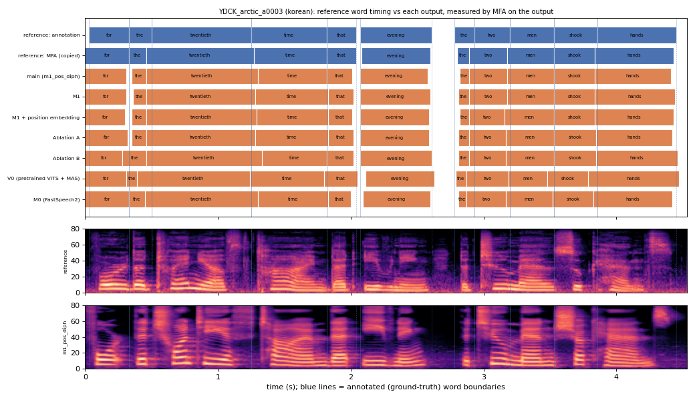

# YDCK_arctic_a0003 (korean, held-out test speaker)

**Selected as:** headline prompt

**Text:** For the twentieth time that evening the two men shook hands

**Reference (ground truth):** [`reference.wav`](reference.wav), L2-ARCTIC `YDCK/wav/arctic_a0003.wav`, 4.53 s; ground-truth word timing: [`reference_annotation.TextGrid`](reference_annotation.TextGrid) (L2-ARCTIC manual annotation, the reference for every MAE below)

| System | Output | Length error (samples) | Word-boundary MAE (ms, MFA on output) | WER | UTMOS | US prob |
|---|---|---|---|---|---|---|
| main (m1_pos_diph) | [`m1_pos_diph.wav`](m1_pos_diph.wav) | 0 | 25.0 | 0.000 | 4.49 | 0.98 |
| M1 | [`m1.wav`](m1.wav) | 0 | 21.4 | 0.000 | 3.88 | 0.99 |
| M1 + position embedding | [`m1_pos.wav`](m1_pos.wav) | 0 | 25.9 | 0.000 | 3.97 | 0.99 |
| Ablation A | [`abl_a_pos.wav`](abl_a_pos.wav) | 0 | 21.8 | 0.000 | 4.07 | 0.99 |
| Ablation B | [`abl_b_pos.wav`](abl_b_pos.wav) | 0 | 26.8 | 0.000 | 4.11 | 1.00 |
| V0 (pretrained VITS + MAS) | [`v0.wav`](v0.wav) | 0 | 37.7 | 0.000 | 4.40 | 0.99 |
| M0 (FastSpeech2) | [`m0.wav`](m0.wav) | 0 | 29.1 | 0.091 | 4.41 | 1.00 |

**Word timings** (seconds). *Annotation* = human ground truth; *MFA on reference* = the timing the system copies (input); *output* = MFA on the m1_pos_diph output. Δ = output − annotation; the MAE above is the mean of |Δstart| and |Δend|, recomputed from these files and checked against `per_utt.csv`.

| Word | Annotation | MFA on reference | Output | Δstart (ms) | Δend (ms) |
|---|---|---|---|---|---|
| for | 0.03–0.33 | 0.00–0.33 | 0.00–0.31 | -30.0 | -20.0 |
| the | 0.33–0.50 | 0.33–0.46 | 0.35–0.46 | 20.0 | -40.0 |
| twentieth | 0.50–1.25 | 0.46–1.27 | 0.46–1.30 | -40.0 | 50.0 |
| time | 1.25–1.82 | 1.27–1.82 | 1.30–1.82 | 50.0 | 0.0 |
| that | 1.82–2.04 | 1.82–2.04 | 1.82–2.01 | 0.0 | -30.0 |
| evening | 2.07–2.61 | 2.08–2.60 | 2.07–2.58 | 0.0 | -30.0 |
| the | 2.78–2.93 | 2.80–2.89 | 2.82–2.89 | 40.0 | -40.0 |
| two | 2.93–3.20 | 2.89–3.18 | 2.89–3.18 | -40.0 | -20.0 |
| men | 3.20–3.53 | 3.18–3.53 | 3.18–3.53 | -20.0 | 0.0 |
| shook | 3.53–3.86 | 3.53–3.84 | 3.53–3.84 | 0.0 | -20.0 |
| hands | 3.86–4.45 | 3.84–4.43 | 3.84–4.41 | -20.0 | -40.0 |

All systems' planned and measured word timings: [`timings.json`](timings.json). Each wav is a byte-exact copy of `results/<system>/test/wav/YDCK_arctic_a0003/out.wav` (see `../../../SOURCES.tsv`).
