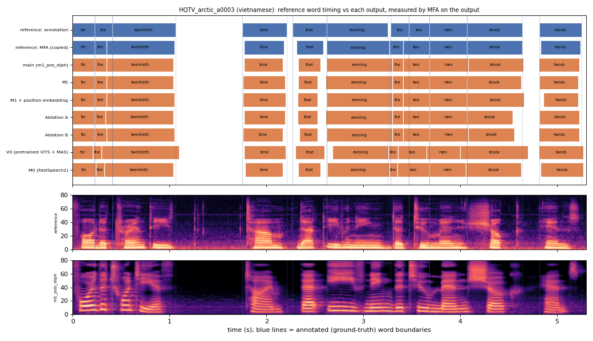

# HQTV_arctic_a0003 (vietnamese, held-out test speaker)

**Selected as:** headline prompt

**Text:** For the twentieth time that evening the two men shook hands

**Reference (ground truth):** [`reference.wav`](reference.wav), L2-ARCTIC `HQTV/wav/arctic_a0003.wav`, 5.30 s; ground-truth word timing: [`reference_annotation.TextGrid`](reference_annotation.TextGrid) (L2-ARCTIC manual annotation, the reference for every MAE below)

| System | Output | Length error (samples) | Word-boundary MAE (ms, MFA on output) | WER | UTMOS | US prob |
|---|---|---|---|---|---|---|
| main (m1_pos_diph) | [`m1_pos_diph.wav`](m1_pos_diph.wav) | 0 | 25.9 | 0.000 | 4.20 | 0.63 |
| M1 | [`m1.wav`](m1.wav) | 0 | 25.5 | 0.000 | 4.49 | 0.31 |
| M1 + position embedding | [`m1_pos.wav`](m1_pos.wav) | 0 | 25.9 | 0.000 | 4.33 | 0.94 |
| Ablation A | [`abl_a_pos.wav`](abl_a_pos.wav) | 0 | 30.0 | 0.000 | 3.79 | 0.93 |
| Ablation B | [`abl_b_pos.wav`](abl_b_pos.wav) | 0 | 30.0 | 0.000 | 4.18 | 0.95 |
| V0 (pretrained VITS + MAS) | [`v0.wav`](v0.wav) | 0 | 44.5 | 0.091 | 4.45 | 0.43 |
| M0 (FastSpeech2) | [`m0.wav`](m0.wav) | 0 | 33.2 | 0.000 | 4.12 | 0.26 |

**Word timings** (seconds). *Annotation* = human ground truth; *MFA on reference* = the timing the system copies (input); *output* = MFA on the m1_pos_diph output. Δ = output − annotation; the MAE above is the mean of |Δstart| and |Δend|, recomputed from these files and checked against `per_utt.csv`.

| Word | Annotation | MFA on reference | Output | Δstart (ms) | Δend (ms) |
|---|---|---|---|---|---|
| for | 0.00–0.23 | 0.00–0.23 | 0.00–0.23 | 0.0 | 0.0 |
| the | 0.23–0.41 | 0.23–0.35 | 0.23–0.35 | 0.0 | -60.0 |
| twentieth | 0.41–1.06 | 0.35–1.05 | 0.35–1.04 | -60.0 | -20.0 |
| time | 1.75–2.21 | 1.77–2.18 | 1.77–2.17 | 20.0 | -40.0 |
| that | 2.27–2.62 | 2.31–2.59 | 2.33–2.56 | 60.0 | -60.0 |
| evening | 2.62–3.25 | 2.62–3.27 | 2.62–3.30 | 0.0 | 50.0 |
| the | 3.28–3.47 | 3.27–3.41 | 3.30–3.41 | 20.0 | -60.0 |
| two | 3.47–3.68 | 3.41–3.68 | 3.41–3.68 | -60.0 | 0.0 |
| men | 3.68–4.07 | 3.68–4.07 | 3.68–4.08 | 0.0 | 10.0 |
| shook | 4.07–4.64 | 4.07–4.64 | 4.08–4.65 | 10.0 | 10.0 |
| hands | 4.82–5.25 | 4.83–5.24 | 4.81–5.23 | -10.0 | -20.0 |

All systems' planned and measured word timings: [`timings.json`](timings.json). Each wav is a byte-exact copy of `results/<system>/test/wav/HQTV_arctic_a0003/out.wav` (see `../../../SOURCES.tsv`).
