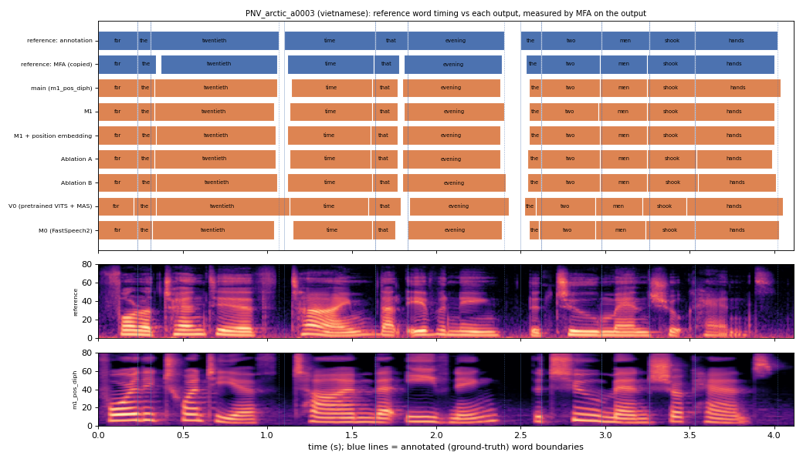

# PNV_arctic_a0003 (vietnamese, held-out test speaker)

**Selected as:** headline prompt

**Text:** For the twentieth time that evening the two men shook hands

**Reference (ground truth):** [`reference.wav`](reference.wav), L2-ARCTIC `PNV/wav/arctic_a0003.wav`, 4.12 s; ground-truth word timing: [`reference_annotation.TextGrid`](reference_annotation.TextGrid) (L2-ARCTIC manual annotation, the reference for every MAE below)

| System | Output | Length error (samples) | Word-boundary MAE (ms, MFA on output) | WER | UTMOS | US prob |
|---|---|---|---|---|---|---|
| main (m1_pos_diph) | [`m1_pos_diph.wav`](m1_pos_diph.wav) | 0 | 15.9 | 0.000 | 4.29 | 0.99 |
| M1 | [`m1.wav`](m1.wav) | 0 | 15.9 | 0.000 | 4.17 | 0.94 |
| M1 + position embedding | [`m1_pos.wav`](m1_pos.wav) | 0 | 17.3 | 0.000 | 4.16 | 0.99 |
| Ablation A | [`abl_a_pos.wav`](abl_a_pos.wav) | 0 | 17.7 | 0.091 | 4.05 | 0.96 |
| Ablation B | [`abl_b_pos.wav`](abl_b_pos.wav) | 0 | 16.4 | 0.091 | 3.88 | 1.00 |
| V0 (pretrained VITS + MAS) | [`v0.wav`](v0.wav) | 0 | 32.7 | 0.000 | 4.48 | 0.90 |
| M0 (FastSpeech2) | [`m0.wav`](m0.wav) | 0 | 19.1 | 0.091 | 4.09 | 0.99 |

**Word timings** (seconds). *Annotation* = human ground truth; *MFA on reference* = the timing the system copies (input); *output* = MFA on the m1_pos_diph output. Δ = output − annotation; the MAE above is the mean of |Δstart| and |Δend|, recomputed from these files and checked against `per_utt.csv`.

| Word | Annotation | MFA on reference | Output | Δstart (ms) | Δend (ms) |
|---|---|---|---|---|---|
| for | 0.00–0.23 | 0.00–0.23 | 0.00–0.23 | 0.0 | 0.0 |
| the | 0.23–0.31 | 0.23–0.34 | 0.23–0.33 | 0.0 | 20.0 |
| twentieth | 0.31–1.07 | 0.37–1.06 | 0.33–1.06 | 20.0 | -10.0 |
| time | 1.10–1.64 | 1.12–1.63 | 1.14–1.62 | 40.0 | -20.0 |
| that | 1.64–1.83 | 1.63–1.78 | 1.62–1.77 | -20.0 | -60.0 |
| evening | 1.83–2.40 | 1.81–2.39 | 1.80–2.38 | -30.0 | -20.0 |
| the | 2.50–2.62 | 2.53–2.62 | 2.55–2.62 | 50.0 | 0.0 |
| two | 2.62–2.98 | 2.62–2.97 | 2.62–2.97 | 0.0 | -10.0 |
| men | 2.98–3.26 | 2.97–3.25 | 2.97–3.25 | -10.0 | -10.0 |
| shook | 3.26–3.53 | 3.25–3.53 | 3.25–3.53 | -10.0 | 0.0 |
| hands | 3.53–4.02 | 3.53–4.00 | 3.53–4.04 | 0.0 | 20.0 |

All systems' planned and measured word timings: [`timings.json`](timings.json). Each wav is a byte-exact copy of `results/<system>/test/wav/PNV_arctic_a0003/out.wav` (see `../../../SOURCES.tsv`).
