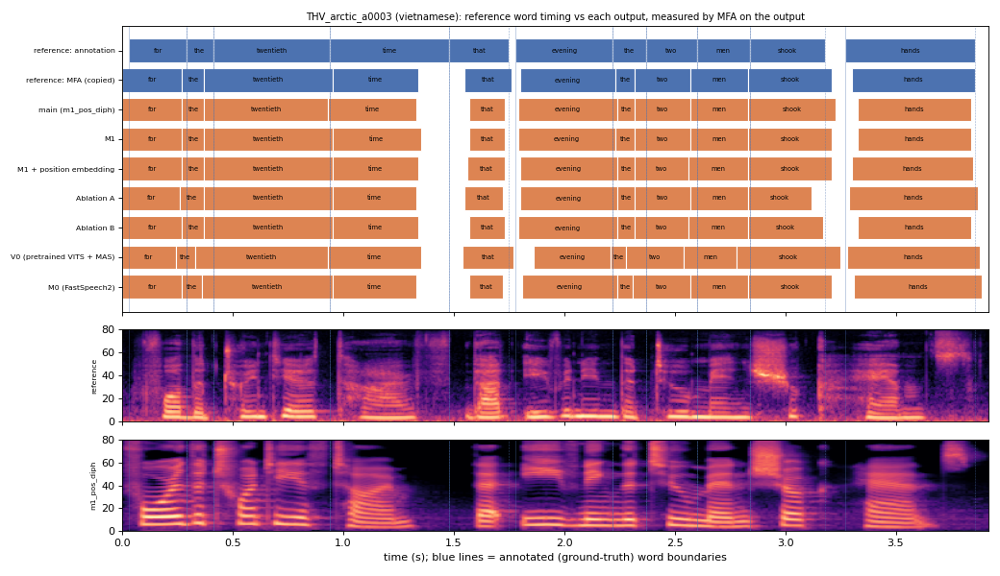

# THV_arctic_a0003 (vietnamese, held-out test speaker)

**Selected as:** headline prompt

**Text:** For the twentieth time that evening the two men shook hands

**Reference (ground truth):** [`reference.wav`](reference.wav), L2-ARCTIC `THV/wav/arctic_a0003.wav`, 3.92 s; ground-truth word timing: [`reference_annotation.TextGrid`](reference_annotation.TextGrid) (L2-ARCTIC manual annotation, the reference for every MAE below)

| System | Output | Length error (samples) | Word-boundary MAE (ms, MFA on output) | WER | UTMOS | US prob |
|---|---|---|---|---|---|---|
| main (m1_pos_diph) | [`m1_pos_diph.wav`](m1_pos_diph.wav) | 0 | 35.9 | 0.000 | 4.16 | 0.97 |
| M1 | [`m1.wav`](m1.wav) | 0 | 33.2 | 0.000 | 4.46 | 0.84 |
| M1 + position embedding | [`m1_pos.wav`](m1_pos.wav) | 0 | 33.6 | 0.000 | 4.48 | 0.96 |
| Ablation A | [`abl_a_pos.wav`](abl_a_pos.wav) | 0 | 35.0 | 0.000 | 4.43 | 0.73 |
| Ablation B | [`abl_b_pos.wav`](abl_b_pos.wav) | 0 | 34.5 | 0.000 | 4.42 | 0.91 |
| V0 (pretrained VITS + MAS) | [`v0.wav`](v0.wav) | 0 | 51.8 | 0.091 | 4.47 | 0.72 |
| M0 (FastSpeech2) | [`m0.wav`](m0.wav) | 0 | 37.7 | 0.000 | 4.43 | 0.98 |

**Word timings** (seconds). *Annotation* = human ground truth; *MFA on reference* = the timing the system copies (input); *output* = MFA on the m1_pos_diph output. Δ = output − annotation; the MAE above is the mean of |Δstart| and |Δend|, recomputed from these files and checked against `per_utt.csv`.

| Word | Annotation | MFA on reference | Output | Δstart (ms) | Δend (ms) |
|---|---|---|---|---|---|
| for | 0.03–0.29 | 0.00–0.27 | 0.00–0.27 | -30.0 | -20.0 |
| the | 0.29–0.41 | 0.27–0.37 | 0.27–0.37 | -20.0 | -40.0 |
| twentieth | 0.41–0.94 | 0.37–0.95 | 0.37–0.93 | -40.0 | -10.0 |
| time | 0.94–1.48 | 0.95–1.34 | 0.93–1.33 | -10.0 | -150.0 |
| that | 1.48–1.75 | 1.55–1.76 | 1.57–1.73 | 90.0 | -20.0 |
| evening | 1.78–2.22 | 1.80–2.23 | 1.79–2.24 | 10.0 | 20.0 |
| the | 2.22–2.37 | 2.23–2.32 | 2.24–2.32 | 20.0 | -50.0 |
| two | 2.37–2.60 | 2.32–2.57 | 2.32–2.57 | -50.0 | -30.0 |
| men | 2.60–2.84 | 2.57–2.83 | 2.57–2.83 | -30.0 | -10.0 |
| shook | 2.84–3.18 | 2.83–3.21 | 2.83–3.23 | -10.0 | 50.0 |
| hands | 3.27–3.86 | 3.30–3.86 | 3.33–3.84 | 60.0 | -20.0 |

All systems' planned and measured word timings: [`timings.json`](timings.json). Each wav is a byte-exact copy of `results/<system>/test/wav/THV_arctic_a0003/out.wav` (see `../../../SOURCES.tsv`).
