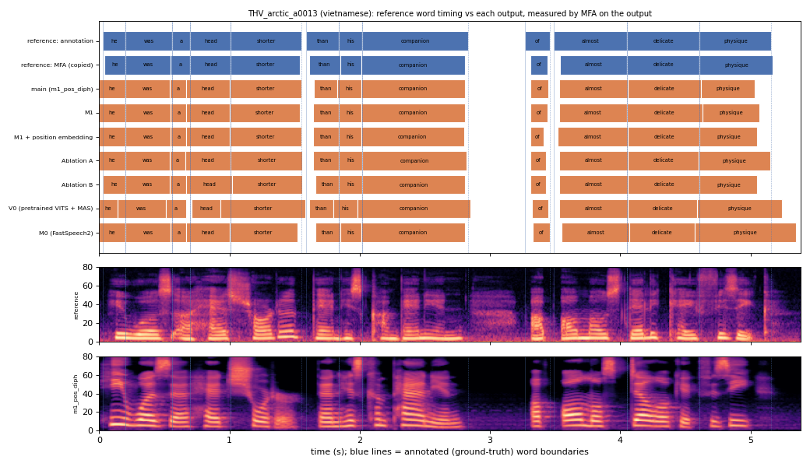

# THV_arctic_a0013 (vietnamese, held-out test speaker)

**Selected as:** median main-system MAE (22.1 ms)

**Text:** He was a head shorter than his companion of almost delicate physique

**Reference (ground truth):** [`reference.wav`](reference.wav), L2-ARCTIC `THV/wav/arctic_a0013.wav`, 5.38 s; ground-truth word timing: [`reference_annotation.TextGrid`](reference_annotation.TextGrid) (L2-ARCTIC manual annotation, the reference for every MAE below)

| System | Output | Length error (samples) | Word-boundary MAE (ms, MFA on output) | WER | UTMOS | US prob |
|---|---|---|---|---|---|---|
| main (m1_pos_diph) | [`m1_pos_diph.wav`](m1_pos_diph.wav) | 0 | 22.1 | 0.000 | 3.97 | 1.00 |
| M1 | [`m1.wav`](m1.wav) | 0 | 19.2 | 0.000 | 4.32 | 0.79 |
| M1 + position embedding | [`m1_pos.wav`](m1_pos.wav) | 0 | 20.0 | 0.000 | 3.97 | 0.97 |
| Ablation A | [`abl_a_pos.wav`](abl_a_pos.wav) | 0 | 15.8 | 0.000 | 3.94 | 0.51 |
| Ablation B | [`abl_b_pos.wav`](abl_b_pos.wav) | 0 | 19.2 | 0.000 | 4.38 | 0.98 |
| V0 (pretrained VITS + MAS) | [`v0.wav`](v0.wav) | 0 | 38.3 | 0.000 | 4.42 | 1.00 |
| M0 (FastSpeech2) | [`m0.wav`](m0.wav) | 0 | 30.0 | 0.000 | 4.09 | 0.98 |

**Word timings** (seconds). *Annotation* = human ground truth; *MFA on reference* = the timing the system copies (input); *output* = MFA on the m1_pos_diph output. Δ = output − annotation; the MAE above is the mean of |Δstart| and |Δend|, recomputed from these files and checked against `per_utt.csv`.

| Word | Annotation | MFA on reference | Output | Δstart (ms) | Δend (ms) |
|---|---|---|---|---|---|
| he | 0.03–0.20 | 0.04–0.20 | 0.00–0.20 | -30.0 | 0.0 |
| was | 0.20–0.56 | 0.20–0.55 | 0.20–0.54 | 0.0 | -20.0 |
| a | 0.56–0.70 | 0.55–0.70 | 0.54–0.67 | -20.0 | -30.0 |
| head | 0.70–1.01 | 0.70–1.01 | 0.67–1.00 | -30.0 | -10.0 |
| shorter | 1.01–1.55 | 1.01–1.54 | 1.00–1.55 | -10.0 | 0.0 |
| than | 1.59–1.84 | 1.61–1.85 | 1.65–1.83 | 60.0 | -10.0 |
| his | 1.84–2.02 | 1.85–2.01 | 1.83–2.01 | -10.0 | -10.0 |
| companion | 2.02–2.83 | 2.01–2.81 | 2.01–2.81 | -10.0 | -20.0 |
| of | 3.27–3.46 | 3.31–3.44 | 3.31–3.45 | 40.0 | -10.0 |
| almost | 3.49–4.05 | 3.54–4.05 | 3.53–4.06 | 40.0 | 10.0 |
| delicate | 4.05–4.61 | 4.05–4.61 | 4.06–4.62 | 10.0 | 10.0 |
| physique | 4.61–5.16 | 4.61–5.17 | 4.62–5.03 | 10.0 | -130.0 |

All systems' planned and measured word timings: [`timings.json`](timings.json). Each wav is a byte-exact copy of `results/<system>/test/wav/THV_arctic_a0013/out.wav` (see `../../../SOURCES.tsv`).
