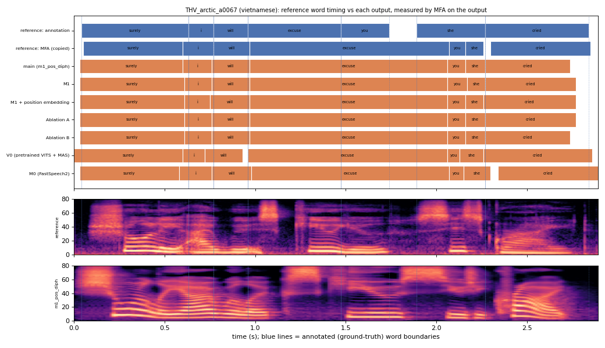

# THV_arctic_a0067 (vietnamese, held-out test speaker)

**Selected as:** worst main-system MAE (148.2 ms)

**Text:** Surely I will excuse you she cried

**Reference (ground truth):** [`reference.wav`](reference.wav), L2-ARCTIC `THV/wav/arctic_a0067.wav`, 2.89 s; ground-truth word timing: [`reference_annotation.TextGrid`](reference_annotation.TextGrid) (L2-ARCTIC manual annotation, the reference for every MAE below)

| System | Output | Length error (samples) | Word-boundary MAE (ms, MFA on output) | WER | UTMOS | US prob |
|---|---|---|---|---|---|---|
| main (m1_pos_diph) | [`m1_pos_diph.wav`](m1_pos_diph.wav) | 0 | 148.2 | 0.000 | 4.37 | 1.00 |
| M1 | [`m1.wav`](m1.wav) | 0 | 146.1 | 0.000 | 3.31 | 1.00 |
| M1 + position embedding | [`m1_pos.wav`](m1_pos.wav) | 0 | 147.5 | 0.286 | 3.56 | 1.00 |
| Ablation A | [`abl_a_pos.wav`](abl_a_pos.wav) | 0 | 144.7 | 0.429 | 3.80 | 1.00 |
| Ablation B | [`abl_b_pos.wav`](abl_b_pos.wav) | 0 | 146.8 | 0.000 | 3.39 | 1.00 |
| V0 (pretrained VITS + MAS) | [`v0.wav`](v0.wav) | 0 | 148.2 | 0.000 | 4.41 | 0.98 |
| M0 (FastSpeech2) | [`m0.wav`](m0.wav) | 0 | 156.3 | 0.571 | 3.75 | 1.00 |

**Word timings** (seconds). *Annotation* = human ground truth; *MFA on reference* = the timing the system copies (input); *output* = MFA on the m1_pos_diph output. Δ = output − annotation; the MAE above is the mean of |Δstart| and |Δend|, recomputed from these files and checked against `per_utt.csv`.

| Word | Annotation | MFA on reference | Output | Δstart (ms) | Δend (ms) |
|---|---|---|---|---|---|
| surely | 0.04–0.63 | 0.05–0.60 | 0.03–0.60 | -10.0 | -30.0 |
| i | 0.63–0.77 | 0.60–0.77 | 0.60–0.76 | -30.0 | -10.0 |
| will | 0.77–0.96 | 0.77–0.97 | 0.76–0.97 | -10.0 | 10.0 |
| excuse | 0.96–1.47 | 0.97–2.07 | 0.97–2.06 | 10.0 | 588.2 |
| you | 1.47–1.74 | 2.07–2.16 | 2.06–2.16 | 588.2 | 419.9 |
| she | 1.89–2.27 | 2.16–2.26 | 2.16–2.27 | 269.1 | 0.0 |
| cried | 2.27–2.84 | 2.30–2.85 | 2.27–2.74 | 0.0 | -100.0 |

All systems' planned and measured word timings: [`timings.json`](timings.json). Each wav is a byte-exact copy of `results/<system>/test/wav/THV_arctic_a0067/out.wav` (see `../../../SOURCES.tsv`).
