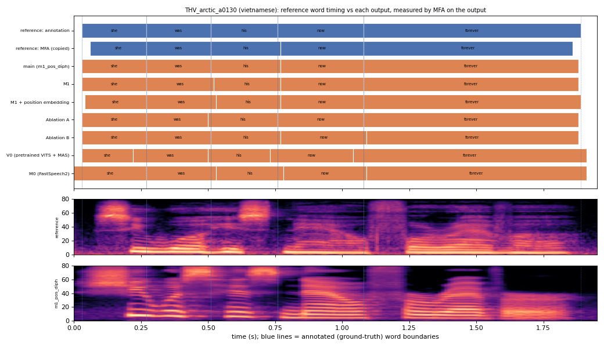

# THV_arctic_a0130 (vietnamese, held-out test speaker)

**Selected as:** best main-system MAE (3.0 ms)

**Text:** She was his now forever

**Reference (ground truth):** [`reference.wav`](reference.wav), L2-ARCTIC `THV/wav/arctic_a0130.wav`, 1.95 s; ground-truth word timing: [`reference_annotation.TextGrid`](reference_annotation.TextGrid) (L2-ARCTIC manual annotation, the reference for every MAE below)

| System | Output | Length error (samples) | Word-boundary MAE (ms, MFA on output) | WER | UTMOS | US prob |
|---|---|---|---|---|---|---|
| main (m1_pos_diph) | [`m1_pos_diph.wav`](m1_pos_diph.wav) | 0 | 3.0 | 0.000 | 4.38 | 1.00 |
| M1 | [`m1.wav`](m1.wav) | 0 | 5.0 | 0.000 | 3.91 | 0.95 |
| M1 + position embedding | [`m1_pos.wav`](m1_pos.wav) | 0 | 7.0 | 0.000 | 4.26 | 0.98 |
| Ablation A | [`abl_a_pos.wav`](abl_a_pos.wav) | 0 | 3.0 | 0.000 | 4.21 | 0.98 |
| Ablation B | [`abl_b_pos.wav`](abl_b_pos.wav) | 0 | 5.0 | 0.000 | 4.01 | 0.97 |
| V0 (pretrained VITS + MAS) | [`v0.wav`](v0.wav) | 0 | 28.0 | 0.000 | 4.30 | 0.09 |
| M0 (FastSpeech2) | [`m0.wav`](m0.wav) | 0 | 15.0 | 0.000 | 3.71 | 0.98 |

**Word timings** (seconds). *Annotation* = human ground truth; *MFA on reference* = the timing the system copies (input); *output* = MFA on the m1_pos_diph output. Δ = output − annotation; the MAE above is the mean of |Δstart| and |Δend|, recomputed from these files and checked against `per_utt.csv`.

| Word | Annotation | MFA on reference | Output | Δstart (ms) | Δend (ms) |
|---|---|---|---|---|---|
| she | 0.03–0.27 | 0.06–0.27 | 0.03–0.27 | 0.0 | 0.0 |
| was | 0.27–0.51 | 0.27–0.51 | 0.27–0.51 | 0.0 | 0.0 |
| his | 0.51–0.76 | 0.51–0.77 | 0.51–0.77 | 0.0 | 10.0 |
| now | 0.76–1.08 | 0.77–1.08 | 0.77–1.08 | 10.0 | 0.0 |
| forever | 1.08–1.89 | 1.08–1.86 | 1.08–1.88 | 0.0 | -10.0 |

All systems' planned and measured word timings: [`timings.json`](timings.json). Each wav is a byte-exact copy of `results/<system>/test/wav/THV_arctic_a0130/out.wav` (see `../../../SOURCES.tsv`).
