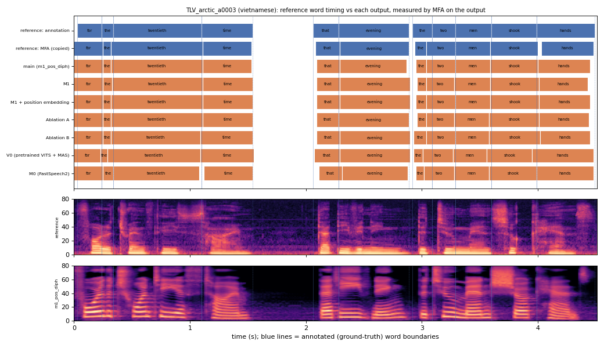

# TLV_arctic_a0003 (vietnamese, held-out test speaker)

**Selected as:** headline prompt

**Text:** For the twentieth time that evening the two men shook hands

**Reference (ground truth):** [`reference.wav`](reference.wav), L2-ARCTIC `TLV/wav/arctic_a0003.wav`, 4.51 s; ground-truth word timing: [`reference_annotation.TextGrid`](reference_annotation.TextGrid) (L2-ARCTIC manual annotation, the reference for every MAE below)

| System | Output | Length error (samples) | Word-boundary MAE (ms, MFA on output) | WER | UTMOS | US prob |
|---|---|---|---|---|---|---|
| main (m1_pos_diph) | [`m1_pos_diph.wav`](m1_pos_diph.wav) | 0 | 18.2 | 0.000 | 4.50 | 0.99 |
| M1 | [`m1.wav`](m1.wav) | 0 | 19.5 | 0.000 | 4.49 | 1.00 |
| M1 + position embedding | [`m1_pos.wav`](m1_pos.wav) | 0 | 18.2 | 0.000 | 4.48 | 0.99 |
| Ablation A | [`abl_a_pos.wav`](abl_a_pos.wav) | 0 | 19.5 | 0.000 | 4.47 | 0.99 |
| Ablation B | [`abl_b_pos.wav`](abl_b_pos.wav) | 0 | 19.1 | 0.000 | 4.45 | 0.98 |
| V0 (pretrained VITS + MAS) | [`v0.wav`](v0.wav) | 0 | 27.3 | 0.091 | 4.49 | 0.85 |
| M0 (FastSpeech2) | [`m0.wav`](m0.wav) | 0 | 20.5 | 0.000 | 4.29 | 0.97 |

**Word timings** (seconds). *Annotation* = human ground truth; *MFA on reference* = the timing the system copies (input); *output* = MFA on the m1_pos_diph output. Δ = output − annotation; the MAE above is the mean of |Δstart| and |Δend|, recomputed from these files and checked against `per_utt.csv`.

| Word | Annotation | MFA on reference | Output | Δstart (ms) | Δend (ms) |
|---|---|---|---|---|---|
| for | 0.03–0.24 | 0.00–0.25 | 0.00–0.25 | -30.0 | 10.0 |
| the | 0.24–0.34 | 0.25–0.32 | 0.25–0.32 | 10.0 | -20.0 |
| twentieth | 0.34–1.10 | 0.32–1.11 | 0.32–1.11 | -20.0 | 10.0 |
| time | 1.10–1.54 | 1.11–1.53 | 1.11–1.53 | 10.0 | -10.0 |
| that | 2.06–2.28 | 2.08–2.29 | 2.09–2.29 | 30.0 | 10.0 |
| evening | 2.28–2.89 | 2.29–2.89 | 2.29–2.87 | 10.0 | -20.0 |
| the | 2.92–3.09 | 2.94–3.04 | 2.95–3.04 | 30.0 | -50.0 |
| two | 3.09–3.29 | 3.04–3.29 | 3.04–3.29 | -50.0 | 0.0 |
| men | 3.29–3.60 | 3.29–3.59 | 3.29–3.59 | 0.0 | -10.0 |
| shook | 3.60–3.99 | 3.59–4.00 | 3.59–4.00 | -10.0 | 10.0 |
| hands | 3.99–4.49 | 4.03–4.48 | 4.00–4.45 | 10.0 | -40.0 |

All systems' planned and measured word timings: [`timings.json`](timings.json). Each wav is a byte-exact copy of `results/<system>/test/wav/TLV_arctic_a0003/out.wav` (see `../../../SOURCES.tsv`).
